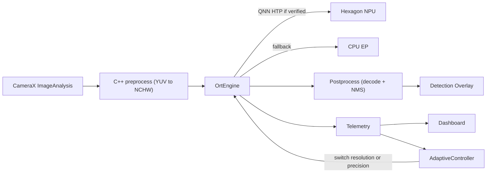

# Snapdragon Edge Vision: Real-Time On-Device Detection with NPU Profiling

An Android app that runs YOLO11n object detection on the live camera feed entirely on-device, and ships with the tooling to optimize and verify it: FP32/FP16/INT8 model variants, ONNX Runtime with the Qualcomm QNN (Hexagon NPU) execution provider, C++/JNI preprocessing, a live profiling dashboard, an adaptive performance controller, reproducible benchmarks, and automated regression tests.

**Stack:** Kotlin, Jetpack Compose, CameraX, C++17 / JNI / Android NDK, ONNX Runtime + QNN EP, Python, PyTorch, Ultralytics, ONNX, Qualcomm AI Hub.

## Architecture



| Module | Responsibility |
|---|---|
| `android/core/native` | C++ preprocessor: YUV_420_888 to RGB, rotation, letterbox, and NCHW float32/float16 normalization in **one fused pass**, written straight into the ORT input buffer |
| `android/core/inference` | `EngineFactory` / `OrtEngine` (QNN HTP, then CPU), zero-copy pinned input/output tensors, `YoloPostprocessor` (decode + class-aware NMS), `ModelRegistry`, `AdaptiveController` |
| `android/core/telemetry` | Rolling p50/p95/p99 per stage, FPS, Java/native heap and PSS, thermal status, thermal headroom, battery temperature, time series and JSON export |
| `android/feature/camera` | CameraX pipeline (`KEEP_ONLY_LATEST` backpressure), overlay, HUD, backend/variant/adaptive controls |
| `android/feature/dashboard` | Live charts and metric cards, backend verification badge, session export |
| `android/feature/benchmark` | Fixed-image benchmark matrix (variant x backend) plus a sustained-load run, exported as JSON |
| `android/app` | Compose navigation, manual DI (`AppContainer`), instrumented benchmark test |
| `ml/` | Export, quantize, evaluate, host benchmark, AI Hub profiling, report generation, pytest gates |

### Design decisions
- **Static-shape ONNX at 320 and 640 px.** QNN HTP requires fixed shapes, so the adaptive resolution feature switches between pre-built variants instead of reshaping.
- **INT8 is static QDQ** (uint8 activations, per-channel int8 weights), the format the QNN EP consumes. The Detect-head decode tail is excluded from quantization because its final concat mixes pixel-scale boxes (0 to 640) with 0-to-1 scores, and a single 8-bit scale for both destroys score precision.
- **One fused native pass.** Nearest-neighbour sampling goes through cached index lookup tables, normalization uses a 256-entry lookup table, and the letterbox padding is written once per geometry instead of every frame. There are no per-frame buffer allocations on either the JNI or the JVM side.
- **Zero-copy ONNX Runtime I/O.** The input tensor wraps the direct buffer the C++ code writes into, and the output is a pinned tensor, so no JVM arrays are allocated per inference.
- **Postprocessing reads class rows sequentially** for cache locality and reuses its scratch arrays.
- **Backend-aware adaptive ladder.** The HTP ladder is 640 FP16, then 640 INT8, then 320 INT8. The CPU ladder starts at 640 FP32, because the CPU execution provider has no FP16 kernels (see the measured results below). The controller steps down on p95 above the 33 ms budget or thermal status MODERATE or higher. It steps up only after a 15 s cooldown with p95 below 60% of the budget, and that hysteresis prevents oscillation between rungs.

## NPU verification: no unverified claims

The app never labels execution as NPU unless it has been verified:

1. `EngineFactory` first creates the session with QNN HTP **and `session.disable_cpu_ep_fallback=1`**. ONNX Runtime rejects that session if any node cannot be assigned to QNN, so success means the whole graph runs on HTP. Only this case shows **"NPU (QNN HTP) - verified"**.
2. If that fails, it retries with CPU fallback allowed. That case is labelled **"QNN HTP + CPU fallback - unverified"**.
3. Otherwise it uses the CPU execution provider, labelled **"CPU fallback"** when NPU was requested.

Independently, `ml/aihub_profile.py` reports Qualcomm AI Hub's per-layer compute-unit breakdown and sets `npu_verified` only when every layer runs on the NPU. It also reports PSNR of the device output against the host ONNX Runtime output as a numerical-correctness check.

## Results

All numbers below were measured. Hardware results are left blank until they've been run on real hardware.

### Host CPU (Apple M-series, ONNX Runtime 1.31 CPU EP, 4 threads, 20 warmup + 200 runs, seed 0)

Accuracy is measured on COCO128 (128 images), which is a proxy for COCO val2017. Absolute mAP is higher than on the official benchmark; the FP32 to FP16 to INT8 deltas are what matter here.

| Variant | Size (MB) | p50 (ms) | p95 (ms) | p99 (ms) | Speedup vs FP32 | mAP50-95 | Delta mAP |
|---|---|---|---|---|---|---|---|
| 320 FP32 | 10.6 | 4.12 | 4.60 | 5.19 | 1.00x | 0.371 | - |
| 320 FP16 | 5.3 | 4.63 | 5.11 | 5.35 | 0.89x | 0.372 | +0.000 |
| 320 INT8 | 3.2 | 3.82 | 4.27 | 5.38 | 1.08x | 0.371 | -0.001 |
| 640 FP32 | 10.7 | 14.35 | 15.09 | 15.29 | 1.00x | 0.503 | - |
| 640 FP16 | 5.4 | 15.25 | 16.05 | 17.35 | 0.94x | 0.503 | -0.000 |
| 640 INT8 | 3.3 | 12.66 | 13.30 | 13.59 | 1.13x | 0.471 | -0.032 |

What this shows:
- INT8 cuts model size by 3.3x and is 8 to 13% faster on CPU. At 640 px it costs 3.2 points of mAP50-95; at 320 px the loss is negligible.
- FP16 halves model size with no accuracy loss, but it is *slower* on a CPU because the CPU EP inserts casts and has no FP16 kernels. FP16's benefit only appears on accelerators like the HTP, which is why the CPU adaptive ladder skips FP16.

Full generated report: [benchmarks/RESULTS.md](benchmarks/RESULTS.md). Raw data: [benchmarks/host_cpu.json](benchmarks/host_cpu.json), [benchmarks/accuracy_host.json](benchmarks/accuracy_host.json).


### Snapdragon NPU (Qualcomm AI Hub)
**Pending: not run yet.** It needs an AI Hub API token. See "Reproduce" below.

### On-device: CPU vs QNN HTP, and sustained load
**Pending: not run yet.** It needs a Snapdragon phone. The benchmark records every variant on CPU and QNN HTP with p50/p95/p99, per-stage timings, and load time. A 10-minute sustained run at camera rate logs FPS, p95, thermal status, headroom, battery temperature, PSS, and every adaptive switch, and charts are generated automatically.

## Reproduce

```bash
scripts/setup_toolchain.sh          # Android cmdline-tools, NDK 27, CMake, platform 35, Python venv
scripts/make_models.sh              # export, quantize, evaluate, host bench, AI Hub (if token), report
cd android && ./gradlew assembleDebug   # models are copied into the APK automatically
```

On a Snapdragon device (USB debugging enabled):

```bash
ITERATIONS=200 SUSTAINED_SECONDS=600 ADAPTIVE=true scripts/run_device_bench.sh
```

This installs the app, runs the instrumented benchmark, pulls the JSON into `benchmarks/device/`, and regenerates `benchmarks/RESULTS.md` with tables and sustained-load charts. To compare against a fixed model, run it again with `ADAPTIVE=false`.

Qualcomm AI Hub (real Snapdragon devices in the cloud):

```bash
ml/.venv/bin/qai-hub configure --api_token <TOKEN>
cd ml && ../ml/.venv/bin/python aihub_profile.py --device "Samsung Galaxy S24 (Family)" && ../ml/.venv/bin/python report.py
```

## Tests

| Suite | What it guards | Command |
|---|---|---|
| Python (10 tests) | FP32 ONNX matches PyTorch; FP16 matches FP32; FP16/INT8 mAP drop within budget (1 / 5 points); INT8 not slower than FP32; p95 within 20% of `baseline_host.json` on the baseline machine; metric/NMS/letterbox correctness | `cd ml && .venv/bin/python -m pytest -q` |
| C++ (ctest) | Letterbox math, YUV (planar and interleaved) color conversion, 90-degree rotation, FP16 output, padding written only once | see `android/core/native/src/main/cpp/CMakeLists.txt` |
| JVM (10 tests) | Latency percentiles (numpy-compatible), FPS meter, NMS and letterbox unmapping, adaptive controller transitions and hysteresis | `cd android && ./gradlew testDebugUnitTest` |
| Instrumented | Full benchmark on device; percentiles ordered | `scripts/run_device_bench.sh` |

CI ([.github/workflows/ci.yml](.github/workflows/ci.yml)) builds the models, runs every host suite, and builds the APK and test APK.

## Known limitations
- No device or NPU numbers yet (see Pending above). The app and scripts are ready, but hardware results haven't been run.
- The APK is about 140 MB because the QNN runtime bundles HTP libraries for every Hexagon generation (V68 to V81). A production build would split by SoC or use Play Feature Delivery.
- The QNN context binary cache (`ep.context_enable`) isn't wired up yet. It would cut first-load time on HTP.
