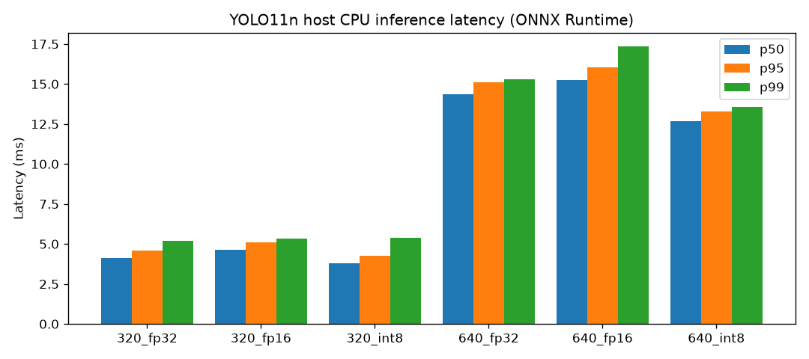

# Benchmark Results

Generated by `ml/report.py`. Do not edit by hand.

## Host CPU (ONNX Runtime)

Environment: Darwin 25.6.0 (arm64), ONNX Runtime 1.31.0, 4 threads, 20 warmup + 200 timed runs, seed 0.

| Variant | Size (MB) | p50 (ms) | p95 (ms) | p99 (ms) | Speedup vs FP32 | mAP50 | mAP50-95 | Delta mAP50-95 |
|---|---|---|---|---|---|---|---|---|
| yolo11n_320_fp32 | 10.62 | 4.117 | 4.603 | 5.194 | 1.00x | 0.5061 | 0.3713 | +0.0000 |
| yolo11n_320_fp16 | 5.34 | 4.626 | 5.108 | 5.345 | 0.89x | 0.5033 | 0.3715 | +0.0002 |
| yolo11n_320_int8 | 3.17 | 3.816 | 4.272 | 5.381 | 1.08x | 0.5096 | 0.3708 | -0.0005 |
| yolo11n_640_fp32 | 10.74 | 14.351 | 15.093 | 15.285 | 1.00x | 0.6709 | 0.5031 | +0.0000 |
| yolo11n_640_fp16 | 5.4 | 15.247 | 16.047 | 17.346 | 0.94x | 0.6717 | 0.5028 | -0.0003 |
| yolo11n_640_int8 | 3.3 | 12.663 | 13.295 | 13.586 | 1.13x | 0.6267 | 0.4713 | -0.0318 |

## Snapdragon via Qualcomm AI Hub

_Pending: no measurements yet. See the README for the one-command reproduction steps._

## On-device (app benchmark mode)

_Pending: no measurements yet. See the README for the one-command reproduction steps._
